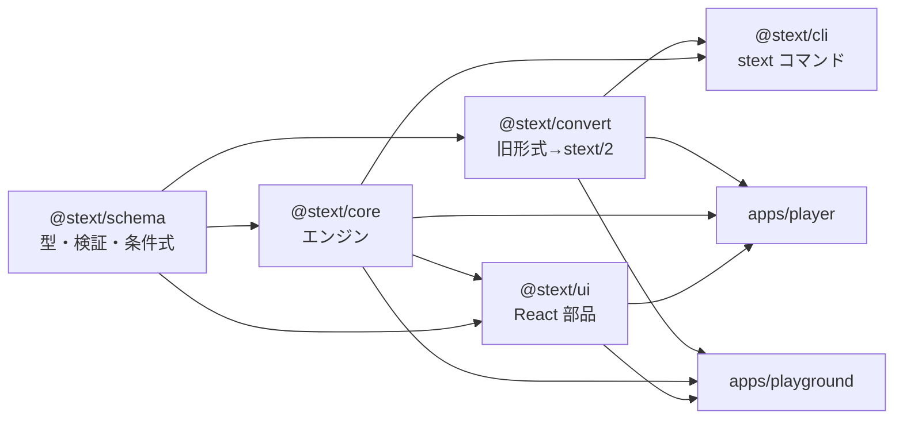
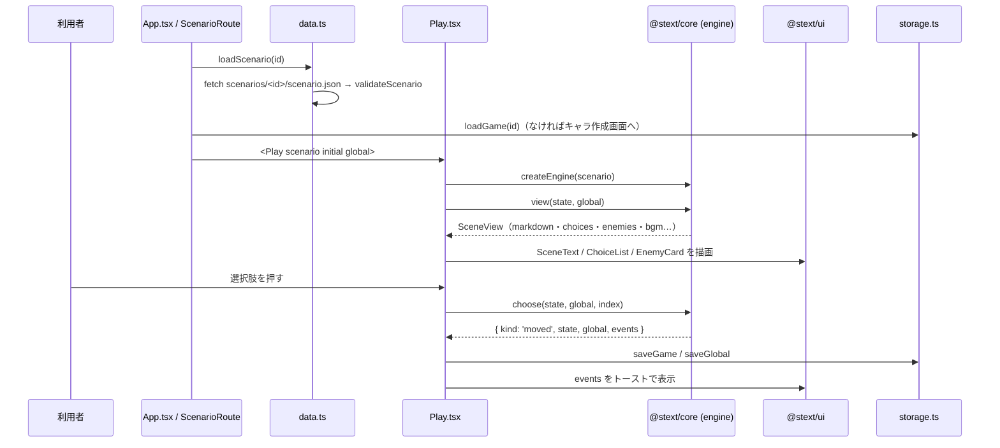

# コードの読み解き方ガイド

stext-next のコードを初めて読む人が、**どこから、どの順番で、何に注目して読めばよいか**をまとめた文書です。

- 決定事項と経緯は [project-notes.md](project-notes.md)、[migration-plan.md](migration-plan.md)
- 開発の手順（コマンド、テスト、生成物）は [development.md](development.md)
- シナリオ JSON の書き方は [scenario-format.md](scenario-format.md)
- エンジンの API の一覧は [engine.md](engine.md)

この文書は、それらを読む前の「地図」として使ってください。

---

## 1. まず押さえる全体像

### 1.1 ひとことで言うと

**旧ソーサリアンText（jQuery 製のゲームブック）を、「シナリオ JSON（stext/2）＋ 環境に依存しないエンジン ＋ React の画面」に作り直したもの**です。

```
旧 scenario.xml ──(@stext/convert)──▶ scenario.json（stext/2）
                                          │
                                          ▼  @stext/schema で検証
                                   @stext/core（エンジン）
                                          │  SceneView（表示用データ）
                     ┌────────────────────┼─────────────────────┐
                     ▼                    ▼                     ▼
              apps/player           apps/playground         packages/cli
         （ブラウザで遊ぶ）     （シナリオを編集・試遊）   （convert / validate / play）
                     └──── @stext/ui（React 部品・スタイル）を共有 ────┘
```

### 1.2 パッケージの依存の向き



矢印は「使われる側 → 使う側」です。**下の層は上の層を知りません**（例：`core` は React も DOM も知らない）。逆向きの依存は作らない決まりです。

### 1.3 動く環境で 3 つに分かれる

| 区分 | 場所 | 使ってよいもの |
| --- | --- | --- |
| **Universal**（ブラウザでも Node でも動く） | `packages/schema`、`packages/core`、`packages/convert` | 純粋な TypeScript だけ。`window`・`localStorage`・`process`・`node:*` は **ESLint でエラー** |
| **Node** | `packages/cli`、`scripts/*.mjs` | `node:fs` など |
| **Browser** | `packages/ui`、`apps/player`、`apps/playground` | React、DOM、`localStorage`、`fetch` |

Universal のコードでは、乱数・保存先・素材の URL など環境に依存するものは**引数で受け取ります**（例：`createEngine(scenario, { random, cache })`）。コードを読んでいて「この値はどこから来るのか」と迷ったら、まず呼び出し側（アプリや CLI）を見てください。

---

## 2. 読む順番（おすすめ）

上から順に読むと、下の層の知識を前提に上の層を理解できます。行数は目安です。

| 順 | ファイル | 見るところ |
| --- | --- | --- |
| 1 | [README.md](../README.md)、[.github/copilot-instructions.md](../.github/copilot-instructions.md) | 何ができるか、構成と決まりの要約 |
| 2 | [scenarios/mini/scenario.json](../scenarios/mini/scenario.json) など小さなシナリオ | 実データの形。`meta`、`scenes[]`、`choices[]`、`effects` |
| 3 | [packages/schema/src/scenario.ts](../packages/schema/src/scenario.ts)（約 300 行） | zod スキーマ＝**データ構造の正本**。型はすべてここから生成される |
| 4 | [packages/schema/src/condition.ts](../packages/schema/src/condition.ts) | 条件式。文字列の記法を AST に変える `parseCondition` |
| 5 | [packages/core/src/index.ts](../packages/core/src/index.ts) | エンジンが外に出しているものの一覧 |
| 6 | [packages/core/src/engine.ts](../packages/core/src/engine.ts)（約 480 行） | **中心**。`createEngine` が返す `start` / `view` / `choose` / `enterScene` |
| 7 | [packages/core/src/state.ts](../packages/core/src/state.ts) | `GameState` / `GlobalState`（セーブデータの形） |
| 8 | [packages/core/src/effects.ts](../packages/core/src/effects.ts)、[text.ts](../packages/core/src/text.ts)、[condition.ts](../packages/core/src/condition.ts) | シーンの効果、本文の `${...}` 展開、条件の評価 |
| 9 | [packages/core/src/engine.test.ts](../packages/core/src/engine.test.ts) | エンジンの使い方の実例（テストが仕様書代わり） |
| 10 | [apps/player/src/App.tsx](../apps/player/src/App.tsx) → [screens/Play.tsx](../apps/player/src/screens/Play.tsx) | エンジンを画面につなぐ方法 |
| 11 | [packages/ui/src/SceneText.tsx](../packages/ui/src/SceneText.tsx) | エンジンが返した Markdown を描画する方法 |
| 12 | [apps/playground/src/App.tsx](../apps/playground/src/App.tsx) → [model.ts](../apps/playground/src/model.ts) → [store.ts](../apps/playground/src/store.ts) | 編集環境。シナリオの編集操作と保存 |
| 13 | [packages/convert/src/legacy.ts](../packages/convert/src/legacy.ts) → [to-v2.ts](../packages/convert/src/to-v2.ts) | 旧形式からの変換（旧形式に関わる作業をするときだけ） |

> 時間がないときは **3 → 6 → 10** の 3 つだけでも、全体の流れはつかめます。

---

## 3. 設計の柱（読む前に知っておくと迷わないこと）

### 3.1 状態は「値として受け渡す」

エンジンは**渡された状態を書き換えず、新しい状態を返します**（内部で JSON 複製してから変更）。

```ts
const engine = createEngine(scenario, { scenarioId: 'scepter' });
let { state, global } = engine.start(emptyGlobalState());
const view = engine.view(state, global);          // 表示用データを作るだけ
const r = engine.choose(state, global, view.choices[0].index);
if (r.kind === 'moved') ({ state, global } = r);  // 新しい状態を受け取る
```

- 「戻る」の履歴は、エンジンではなく**呼び出し側が以前の状態を持っておく**ことで実現しています（[Play.tsx](../apps/player/src/screens/Play.tsx) の `history`）。
- Playground の編集操作（[model.ts](../apps/playground/src/model.ts)）も同じ考え方で、元のシナリオを書き換えず新しいシナリオを返します。元に戻す／やり直すはこれを積み重ねて実現しています。
- 例外：[effects.ts](../packages/core/src/effects.ts) の関数は**渡された状態を直接書き換えます**。`engine.ts` が複製してから渡す前提です。戦闘処理で `engine.effectContext()` を使うときも、呼び出し側で複製してから渡します。

### 3.2 旧エンジンとの互換が最優先

進行の規則・計算式・セーブデータの形は、旧エンジン（[snext1220/stext](https://github.com/snext1220/stext) の `sgml.js`）と同じです。差分テストで 43 シナリオ・7,115 手が一致することを確かめています。

そのため、コードには一見不思議な部分があります。**多くは旧エンジンに合わせた結果**なので、直す前にコメントと旧コードを確認してください。

| 見かけ | 理由 |
| --- | --- |
| `ellapsed_scene`（綴りが違う） | 旧セーブデータのキー名そのまま |
| localStorage のキーがシナリオ ID と `sorcerian_text` | 旧エンジンのセーブデータをそのまま読めるようにするため |
| 遷移先 `90000` | 「戻る」。`p99` があればそのシーンへ、なければ呼び出し側で直前に戻す |
| パラメーター `p<アイテムID>` | アイテムの個数（旧エンジンの `params_map`） |
| `"full"`、`"-5..-1"`、`"@3"` などの文字列 | 効果の値の書き方を旧形式から引き継いでいる |
| コメントの「旧エンジン ○○ と同じ」 | 対応する旧関数名。旧コードと突き合わせるときの手がかり |

### 3.3 シナリオの形は zod スキーマが正本

- 型（`Scenario`、`Scene`、`Choice` …）は [scenario.ts](../packages/schema/src/scenario.ts) の zod スキーマから `z.infer` で作っています。
- JSON Schema（[schema/scenario.v2.json](../schema/scenario.v2.json)）もここから生成します（手で編集しない）。
- 検証は 2 段階です。
  - `validateScenario`：構造が正しいか（zod）
  - `checkScenario`（[check.ts](../packages/schema/src/check.ts)）：遷移先があるか、条件が読めるかなどの整合性

### 3.4 条件式は AST が正式、文字列も受け付ける

選択肢の `if` は、AST（`{ all: [{ flag: 'f01' }, ...] }`）と文字列（旧記法）の両方を受け付けます。

- 文字列 → AST：[schema/src/condition.ts](../packages/schema/src/condition.ts) の `parseCondition`
- AST の評価：[core/src/condition.ts](../packages/core/src/condition.ts) の `evaluateCondition`
- 本文中の `${if ...}` の評価：[core/src/text.ts](../packages/core/src/text.ts) の `judge`（解析結果をキャッシュ）

---

## 4. 処理の流れを追う

### 4.1 プレイヤーで 1 手進むまで



### 4.2 エンジンの中（シーンに入るとき）

[engine.ts](../packages/core/src/engine.ts) の `enterScene` は、旧エンジンの `createScene` と同じ順序で処理します。

1. 魔法を唱える選択肢なら、星を消費する（足りなければ移動しない）
2. `applySceneEffects`（[effects.ts](../packages/core/src/effects.ts)）
   アイテム → フラグ → パラメーター → 星 → 最大値 → HP/MP → 能力値 → free → 状態異常 → 状態異常の経過 → 実績 → ボーナス
3. 現在のシーン・経過シーン数・BGM を更新する
4. エンディングなら、続編への引き継ぎ（`carryOver`）とボーナスアイテムを決める

`view` は表示用のデータを組み立てるだけで、状態は変えません。本文の `${...}` は [text.ts](../packages/core/src/text.ts) の `expandText` で展開され、ルビや入力欄などは HTML（`<ruby>`、`<stext-input>` など）として `markdown` に入ります。

### 4.3 本文の描画

[SceneText.tsx](../packages/ui/src/SceneText.tsx) は次の順で描画します。

1. `legacyMarkdown`：旧エンジンの Markdown に合わせる前処理（`--` の区切り線、日本語の太字）
2. `marked`：Markdown → HTML
3. `DOMPurify`：安全なタグだけに絞る（`stext-input`、`ruby` などは許可）
4. `html-react-parser`：`<stext-input>` を入力欄、`.stext-effect` を演出の部品に置き換える

### 4.4 旧形式の変換

```
scenario.xml ─ readScenarioXml ─┐
                                ├─▶ LegacyScenario ─ toV2 ─▶ Scenario（stext/2）＋ 警告・統計
旧 Playground JSON ─ readPlaygroundJson ─┘
```

- [legacy.ts](../packages/convert/src/legacy.ts)：旧形式を中間形式 `LegacyScenario` に読み込む（XML は fast-xml-parser）
- [to-v2.ts](../packages/convert/src/to-v2.ts)：本文中のリンクから `choices[]` を取り出す（`extractChoices`）、効果の属性を `effects` にする（`sceneEffects`）など
- 変換は一方向です。stext/2 から XML へ戻す機能はありません。

### 4.5 素材（画像・BGM）の URL

[apps/player/src/config.ts](../apps/player/src/config.ts) で組み立てます。

| 素材 | URL |
| --- | --- |
| シナリオ | `${VITE_SCENARIO_BASE}<id>/scenario.json` |
| 挿絵 | `${VITE_SCENARIO_BASE}<id>/capture/<ファイル>` |
| BGM（`@` で始まる） | `${VITE_ASSET_BASE}common/bgm/<名前>.mp3` |
| BGM（それ以外） | `${VITE_SCENARIO_BASE}<id>/bgm/<名前>.mp3` |
| キャラクター画像 | `${VITE_ASSET_BASE}common/<性別>_<年齢>_<種族>.png`（`imageSet` が `custom` なら `${VITE_SCENARIO_BASE}<id>/chara/` 以下） |

開発サーバーでは、[apps/player/vite.config.ts](../apps/player/vite.config.ts) の `publish` プラグインがリポジトリの `scenarios/` と `assets/` を配信し、ビルド時には `dist/` にコピーします。

---

## 5. 場所ごとの読みどころ

### 5.1 packages/core

| ファイル | 役割 |
| --- | --- |
| [engine.ts](../packages/core/src/engine.ts) | `createEngine`。進行（start / begin / enterScene / choose）、表示（view）、魔法・アイテム・入力欄 |
| [state.ts](../packages/core/src/state.ts) | セーブデータの型、キャラクター生成（`newGameState`）、旧セーブデータの読み込み |
| [effects.ts](../packages/core/src/effects.ts) | シーンの効果の適用、`GameEvent`（UI に伝える出来事） |
| [text.ts](../packages/core/src/text.ts) | 本文の `${...}` マクロの展開、`${import ...}`、共通フッター |
| [condition.ts](../packages/core/src/condition.ts) | 条件 AST の評価 |
| [battle.ts](../packages/core/src/battle.ts) | ダイス、ダメージ計算、敵への攻撃、戦利品。**UI から一つずつ呼ぶ**部品 |
| [magic.ts](../packages/core/src/magic.ts) | 魔法と必要な星 |
| [rank.ts](../packages/core/src/rank.ts) | プレイヤーランク |
| [data.ts](../packages/core/src/data.ts) | 名前・称号・種族の初期値・職業・ボーナスアイテムなどの固定データ（行数の大半はデータ） |
| [random.ts](../packages/core/src/random.ts) | 乱数の道具。`seededRandom` で再現できる乱数を作れる |

### 5.2 apps/player

| ファイル | 役割 |
| --- | --- |
| [main.tsx](../apps/player/src/main.tsx) → [App.tsx](../apps/player/src/App.tsx) | 起点。ヘッダーと画面の切り替え、`GlobalState` と設定を持つ |
| [router.ts](../apps/player/src/router.ts) | ハッシュによる画面遷移（`#/play/<id>` など）。ライブラリは使っていない |
| [data.ts](../apps/player/src/data.ts) | `index.json` とシナリオの読み込み・検証・キャッシュ |
| [storage.ts](../apps/player/src/storage.ts) | localStorage への保存（使えないときはメモリ） |
| [screens/Library.tsx](../apps/player/src/screens/Library.tsx) | 書庫（シナリオ一覧と、プロローグを出す詳細） |
| [libraryFilter.ts](../apps/player/src/libraryFilter.ts) | 書庫の検索条件による絞り込みと並べ替え |
| [screens/Create.tsx](../apps/player/src/screens/Create.tsx) | キャラクター作成 |
| [screens/Play.tsx](../apps/player/src/screens/Play.tsx)（約 600 行） | 冒険の画面。選択・戻る・魔法・アイテム・戦闘・BGM・トースト |
| [screens/Records.tsx](../apps/player/src/screens/Records.tsx) | 記録（ランク、ボーナス、バックアップ／リストア） |
| [screens/Convert.tsx](../apps/player/src/screens/Convert.tsx) | 変換所。`React.lazy` で開いたときだけ読み込む |
| [audio.ts](../apps/player/src/audio.ts)、[backup.ts](../apps/player/src/backup.ts) | BGM・効果音の再生、`.stext` ファイルの読み書き |

`Play.tsx` は長いので、`// ───── 戦闘 ─────` のような区切りコメントを目印に、まとまりごとに読むと楽です。

### 5.3 apps/playground

| ファイル | 役割 |
| --- | --- |
| [App.tsx](../apps/playground/src/App.tsx) | 全体の配置、ファイルを開く・保存する、タブの切り替え、Ctrl+Z |
| [model.ts](../apps/playground/src/model.ts) | 編集操作（シーン・選択肢の追加／削除／改名など）。**純粋関数**なのでテストしやすい |
| [store.ts](../apps/playground/src/store.ts) | 元に戻す／やり直す、自動保存、マイストレージ |
| [FlowView.tsx](../apps/playground/src/FlowView.tsx)、[layout.ts](../apps/playground/src/layout.ts) | React Flow のフロー図と、dagre による自動配置。グラフは `model.ts` の `toGraph` で `choices` から作る |
| [SceneEditor.tsx](../apps/playground/src/SceneEditor.tsx)、[Definitions.tsx](../apps/playground/src/Definitions.tsx)、[fields.tsx](../apps/playground/src/fields.tsx) | 「シーン」「定義」タブの入力フォーム |
| [checks.ts](../apps/playground/src/checks.ts)、[Problems.tsx](../apps/playground/src/Problems.tsx) | 「検査」タブ（`checkScenario` の結果を表示） |
| [TestPlay.tsx](../apps/playground/src/TestPlay.tsx) | 「試遊」タブ。プレイヤーと同じエンジンを使う |
| [help/](../apps/playground/src/help/) | ヘルプ。内容は [reference.md](../apps/playground/src/help/reference.md)（旧 `reference.xml` を移したもの）、読み込みは [help.ts](../apps/playground/src/help/help.ts)、表示は [HelpPanel.tsx](../apps/playground/src/help/HelpPanel.tsx)。フォームの欄は `help="キー"` で項目を指す |

### 5.4 packages/ui

React の部品と [styles.css](../packages/ui/src/styles.css)（デザイントークン）です。部品はどれも props を受け取って描画するだけで、エンジンを直接は呼びません。見た目の基準は [prototype/design/index.html](../prototype/design/index.html)（「夜の書見台」）です。

### 5.5 packages/cli と scripts

- [cli/src/index.ts](../packages/cli/src/index.ts)：`run(argv, io)` が終了コードを返す形。標準入出力と `process` は [bin.ts](../packages/cli/src/bin.ts) だけに置いているので、テストでは `io` を差し替えられます。
- `scripts/`：ビルドや確認の補助（Node で動く `.mjs`）。

| スクリプト | 内容 |
| --- | --- |
| `build-site.mjs` | GitHub Pages 用に `site/` を組み立てる |
| `difftest.mjs` | 旧エンジンとの差分テスト（Chromium と playwright が必要） |
| `e2e-player.mjs`、`e2e-playground.mjs` | ブラウザでの一通りの操作確認 |
| `import-legacy-assets.mjs`、`import-playground-templates.mjs` | 旧リポジトリから素材・テンプレートを取り込む |
| `write-json-schema.mjs` | `schema/scenario.v2.json` を作る |

---

## 6. 手を動かして理解する

読むだけより、動かしながらのほうが早く分かります。

**1. テストを流す**（テストは対象ファイルの隣の `*.test.ts(x)`）

```bash
npm test
```

**2. コマンドラインで遊ぶ**（エンジンだけの動きを、画面なしで確かめられる）

```bash
npm run build
```

```bash
node packages/cli/dist/bin.js play scenarios/mini/scenario.json
```

```bash
node packages/cli/dist/bin.js play scenarios/mini/scenario.json --auto 30 --seed 1
```

**3. 画面で遊ぶ**

```bash
npm run dev
```

**4. Playground で小さなシナリオを作り、「試遊」で動かす**

```bash
npm run dev:playground
```

テンプレート「empty」から始めて、選択肢・効果・条件を一つずつ足し、生成された JSON（「保存（JSON）」）と [scenario.ts](../packages/schema/src/scenario.ts) を見比べると、形式とエンジンの関係がよく分かります。

---

## 7. つまずきやすい点

| 症状・疑問 | 答え |
| --- | --- |
| `import ... from './engine.js'` なのに `engine.ts` しかない | ESM の決まりで、相対 import には `.js` を付ける。TypeScript が `.ts` に読み替える |
| `@stext/core` を変えたのにアプリに反映されない？ | 開発サーバーとテストは [workspace-aliases.ts](../workspace-aliases.ts) で `src/` を直接見ているので、ビルド不要で反映される。CLI（`dist/`）は `npm run build` が必要 |
| `scenarios/` の JSON を直したい | 変換の生成物。直すなら旧シナリオか変換器を直し、`npm run convert:legacy` で作り直す（`../stext` が必要） |
| `schema/scenario.v2.json` が古いとテストが落ちる | `npm run build` のあとに `npm run schema` |
| 選択肢の番号（`index`）が飛んでいる | `view` は条件を満たす選択肢だけ返すが、`index` は全選択肢（共通フッターを含む）での位置。`choose` にはその `index` を渡す |
| Universal パッケージで `localStorage` を使いたい | 使えない。引数（`EngineOptions` など）で受け取り、アプリ側で実装を渡す |
| シーン ID が数値なのに文字列 | stext/2 では ID は文字列。`state.scene` は旧データとの互換で数値のこともあるので `String()` で比べる |

---

## 8. 目的別の入口

| やりたいこと | まず見る場所 |
| --- | --- |
| シナリオの項目を増やす | [scenario.ts](../packages/schema/src/scenario.ts) → [effects.ts](../packages/core/src/effects.ts) / [engine.ts](../packages/core/src/engine.ts) → [to-v2.ts](../packages/convert/src/to-v2.ts) → Playground のフォーム。最後に `npm run schema` と [scenario-format.md](scenario-format.md) の更新 |
| 条件式の書き方を増やす | [schema/src/condition.ts](../packages/schema/src/condition.ts)（解析）と [core/src/condition.ts](../packages/core/src/condition.ts)（評価） |
| 本文の `${...}` マクロを増やす | [text.ts](../packages/core/src/text.ts) の `interpolate`。HTML を出すなら [SceneText.tsx](../packages/ui/src/SceneText.tsx) の許可リストも |
| 戦闘の計算を確かめる | [battle.ts](../packages/core/src/battle.ts) と [battle.test.ts](../packages/core/src/battle.test.ts)、画面側は [Play.tsx](../apps/player/src/screens/Play.tsx) の「戦闘」 |
| 画面の見た目を変える | [styles.css](../packages/ui/src/styles.css)（共通）、[playground.css](../apps/playground/src/playground.css)（Playground） |
| 画面を増やす（プレイヤー） | [router.ts](../apps/player/src/router.ts) の `Route` と [App.tsx](../apps/player/src/App.tsx) |
| Playground の編集操作を増やす | [model.ts](../apps/playground/src/model.ts)（新しいシナリオを返す関数）と [model.test.ts](../apps/playground/src/model.test.ts) |
| Playground のヘルプを直す・増やす | [reference.md](../apps/playground/src/help/reference.md)（先頭に書き方）。欄に付けるときは `help="キー"`。確認は [help.test.ts](../apps/playground/src/help/help.test.ts) |
| 旧シナリオの変換結果がおかしい | [scenarios/REPORT.md](../scenarios/REPORT.md) → [to-v2.ts](../packages/convert/src/to-v2.ts) → [convert.test.ts](../packages/convert/src/convert.test.ts) |
| 公開の仕組みを知る | [.github/workflows/pages.yml](../.github/workflows/pages.yml) と `scripts/build-site.mjs` |
