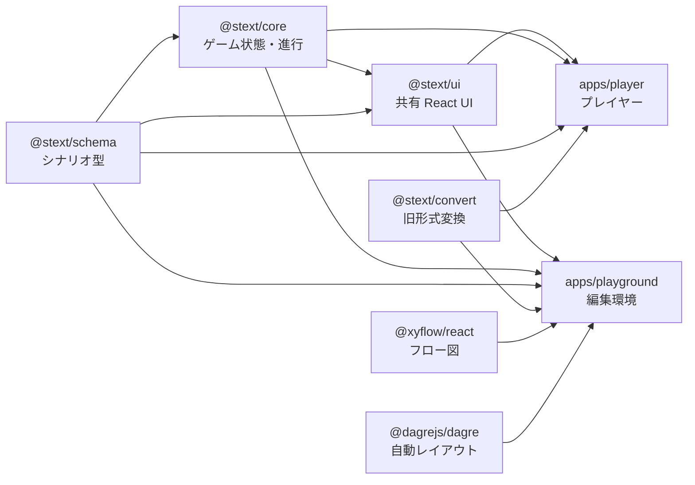

# React コンポーネント一覧

`apps/player`、`apps/playground`、`packages/ui` にある主な React コンポーネントの役割、Props、依存先をまとめた資料です。Props は TypeScript の公開インターフェースを基に、利用時に必要な情報が分かるよう要約しています。省略可能な Props には「任意」と記しています。

## 1. 全体の依存関係

- `packages/ui` はゲーム・シナリオの型を受け取る表示部品を提供します。スタイルは `@stext/ui/styles.css` から読み込みます。
- `apps/player` は `@stext/core` のエンジンを操作し、`@stext/ui` で冒険者・本文・選択肢などを表示します。保存、音声、URL、シナリオ読み込みはアプリ側が担当します。
- `apps/playground` はシナリオ編集の状態を `model.ts` / `store.ts` に集約し、`@stext/ui` を試遊に利用します。フロー図は React Flow、自動レイアウトは dagre を利用します。
- `@stext/convert` は両アプリで旧形式の取り込みに使います。各アプリから共有 UI や下位パッケージへの依存はありますが、共有 UI からアプリへの逆依存はありません。

## 2. `packages/ui` — 共有コンポーネント

公開 API は [packages/ui/src/index.ts](../packages/ui/src/index.ts) から確認できます。React 19 を peer dependency とし、`@stext/core` / `@stext/schema` の型・定数と、本文表示用の `marked`・`dompurify`・`html-react-parser` を利用します。

| コンポーネント | 概要・Props | 主な依存 |
| --- | --- | --- |
| `BrandTitle` | ロゴ見出し。`note?`: タイトル横の補足表示。 | React のみ |
| `Parchment` | ほつれた紙面・五芒星・右下のめくれを表示。`as?`: `div` / `article` / `section`、`className?`、`style?`、`seed?`: 輪郭シード、`curl?`: めくれ幅、`children?`。 | `Pentagram`、`tornPath`、`ResizeObserver` |
| `Pentagram` | 古びた五芒星の SVG 透かし。Props なし。 | SVG |
| `SceneText` | Markdown 本文を安全な HTML に変換して描画。`markdown`、`resolveImage?`: 画像 URL 解決関数、`onParamChange?`: `(id, value)`、`inline?`、`className?`。 | `marked`、`DOMPurify`、`html-react-parser`、`Effect`、`ImagePreview` |
| `ChoiceList` | 通常・番号入力・回答入力の選択肢を描画。`choices: ChoiceView[]`、`onChoose: (index, input?) => void`。 | `@stext/core` の `ChoiceView`、`SceneText` |
| `HeroPanel` | 冒険者情報、HP/MP、能力、状態、ボーナスを表示。`scenario`、`state`、`portraitUrl?`。 | `@stext/core`、`@stext/schema` |
| `RaceSigil` | 種族の紋章を表示。`race`。 | SVG |
| `CharaPortrait` | 顔画像を表示し、画像エラー時は種族紋章に置換。`src?`、`race`。 | `RaceSigil` |
| `MagicPanel` | 星の数と魔法、詠唱可能状態を表示。`state`、`onCast: (name: MagicName) => void`。 | `@stext/core` の魔法・星定義 |
| `ItemsPanel` | 所持アイテム・手記を表示。`scenario`、`state`、`onUse?: (id) => void`。利用可能なアイテムの使用操作は callback があるとき表示。 | `@stext/core`、`@stext/schema` |
| `RecordPanel` | 実績と辿ったシーン履歴を表示。`scenario`、`scenarioId`、`global`、`history: {id, label}[]`、`trophyUrl?: (level) => string`。 | `@stext/core`、`@stext/schema` |
| `Die` | ダイスの目を描画。`value`、`rolling?`、`first?`。7 以上は数字表示。 | React、styles.css |
| `EnemyCard` | 敵の情報、HP、攻撃・戦利品の操作を表示。必須: `enemy`。任意: `func`、`funcDisplayOnly`、`hp`、`dropName`、`dropTaken`、`defeatedChecked`、`onToggleDefeated`、`onReceive`、`onAttack`、`onDrop`、`attackLabel`。 | `@stext/schema` の `Enemy`、`@stext/core` の属性・状態名 |
| `StatusEditor` | 冒険者状態を手入力するフォーム。`scenario`、`state`、`onSave: (state) => void`、`onCancel`。 | `@stext/core` の職業・種族・状態定義、`@stext/schema`、`statusLabel` |
| `Toasts` | 通知一覧を表示。`toasts: Toast[]`（各要素は `id`、`kind`、`title`、`message`）。 | `Toast` 型（`kind`: `item` / `result` / `dmg` / `warn` / `info`） |
| `Effect` | 本文を文字単位のアニメーションにする。`name`、`children`。許可された効果名以外は `fadeIn` で表示。 | React.Children / element cloning、styles.css のアニメーション |
| `ImagePreview` | 画像をクリックしてダイアログで拡大。`src`、`alt`、`className?`、`triggerClassName?`、`width?`、`height?`、`loading?`、`onError?`。 | HTML `<dialog>`、React |

### 表示上の補助 API

- `legacyMarkdown(markdown)` は旧エンジンとの互換用に Markdown を前処理します。`renderMarkdown(markdown, inline?)` は Markdown をサニタイズ済み HTML にします。どちらもコンポーネントではありませんが、Playground のヘルプなどでも利用されています。
- `statusLabel(scenario, key)` はシナリオの `meta.labels` を優先してステータス名を返します。
- `createCookieRandomCache()` はエンジンに渡す乱数キャッシュで、UI コンポーネントではありません。

## 3. `apps/player` — プレイヤー画面

### アプリの構成

`App` はルーターから画面を選び、共通ヘッダー・メニュー・フッターを構成します。シナリオ画面は内部コンポーネント `ScenarioRoute` が非同期ロードし、キャラクター作成またはプレイ画面へつなぎます。案内系の画面と変換所は遅延ロードされます。

| コンポーネント | 概要・Props | 主な依存 |
| --- | --- | --- |
| `App` | URL ルート、全体設定、テーマ、音声、共通ナビゲーションを管理。Props なし。 | `router.ts`、`storage.ts`、`audio.ts`、`data.ts`、各画面、`@stext/core`、`@stext/ui` |
| `ScenarioRoute`（内部） | シナリオをロードし、開始状態に応じて `Create` / `Play` を切り替える。`id`、`mode`、`global`、`onGlobal`、`audio`、`settings`、`onSettings`。 | `data.ts`、`storage.ts`、`Create`、`Play`、`@stext/core` |
| `Menu` | ルートに応じてヘッダーの画面切り替えを表示。`route: Route`。 | `router.ts`。サブメニューの項目は `MENU` 定数 |
| `Footer` | CONTACT と案内ページへのリンクを表示。Props なし。 | `config.ts`、`links.ts`、`router.ts` |
| `Library` | シナリオ一覧、検索・絞り込み・詳細・続きからの導線を表示。`global`、`settings`、`quest?`（感想対象の絞り込み）。 | `data.ts`、`libraryFilter.ts`、`storage.ts`、`SaveDialog`、`@stext/ui` |
| `Create` | シナリオ制約に沿って冒険者を作成し、冒険開始を通知。`id`、`scenario`、`global`、`onStart: (character: GameState) => void`。 | `@stext/core`、`@stext/schema`、`storage.ts`、`@stext/ui` |
| `Play` | エンジンを進行し、本文・選択肢・戦闘・冒険者パネル・セーブなどを統合。Props: `id`、`scenario`、`initial`、`global`、`onGlobal`、`audio`、`settings`、`onSettings`。 | `@stext/core`、`@stext/schema`、`@stext/ui`、`audio.ts`、`config.ts`、`data.ts`、`storage.ts`、`SaveDialog` |
| `SaveDialog` | セーブスロットの保存・ロード・削除。`id`、`state?`、`onLoad: (state) => void または Promise<void>`、`onClose`。`state` があり未終了なら保存モードも使える。 | `storage.ts`、React Portal、ブラウザーの確認ダイアログ |
| `Records` | 全シナリオを通した冒険者ランク、ボーナス、保存データのバックアップ／復元。`global`、`onGlobal`。 | `backup.ts`、`storage.ts`、`data.ts`、`@stext/core`、`@stext/ui` |
| `Convert` | 旧 XML / Playground JSON を stext/2 に変換し、結果を保存・試遊へ接続。Props なし。 | `@stext/convert`、`data.ts`、`router.ts` |
| `Music` | BGM・効果音の試聴、曲を使うシナリオ一覧を表示。Props なし。 | `music.ts`、`data.ts`、`config.ts`、`links.ts` |

### 読み物画面と共通部品

読み物画面は共通の `DocPage` / `DocSheet` を利用します。セクションへのリンクは `DocPage` がルーターのスクロール機能に接続し、画像一覧は共有 UI の `ImagePreview` を通じて拡大できます。

| コンポーネント | 概要・Props | 主な依存 |
| --- | --- | --- |
| `DocPage` | 読み物画面の見出しとコンテンツ枠。`page`、`eyebrow`、`title`、`lede: ReactNode`、`children`、`section?`。 | `router.ts` の `useSectionScroll` |
| `DocSheet` | 羊皮紙 1 枚。`seed`、`children`。 | `@stext/ui` の `Parchment` |
| `DocSection` | ID・見出しを持つ章。`page`、`chapter: {id, title}`、`seed`、`children`、`eyebrow?`。 | `DocSheet` |
| `ExtLink` | 安全属性付きで外部リンクを新しいタブに開く。`href`、`children`。 | HTML anchor |
| `Figures` | キャプション付き画像一覧。`items: {src, caption}[]`、`className?`。 | `@stext/ui` の `ImagePreview` |
| `About` / `Post` | 概要・投稿案内。いずれも `section?`。 | `DocPage` / `DocSection`、`links.ts`、`router.ts`、設定 |
| `Gallery` / `Links` / `Recruit` / `Staff` / `Materials` | 画廊、関連リンク、募集、スタッフ、制作者向け素材を表示。Props なし。 | `DocPage` / `DocSheet`、`ImagePreview`、`config.ts`、`links.ts`、`router.ts`（画面により異なる） |

## 4. `apps/playground` — 編集環境

### 画面と編集コンポーネント

| コンポーネント | 概要・Props | 主な依存 |
| --- | --- | --- |
| `App` | 編集セッション、タブ、選択シーン、ダイアログ、保存・試遊・提出を統合。Props なし。 | `model.ts`、`store.ts`、`archive.ts`、`checks.ts`、`resources.ts`、各 UI 部品、`@stext/schema`、`@stext/convert` |
| `FlowView` | シナリオを React Flow のノード・エッジとして表示し、選択・移動・接続を通知。`scenario`、`selected`、`problems: ReadonlyMap<string, number>`、`onSelect(id)`、`onMove(id,x,y)`、`onConnect(from,to)`。任意: `playingScene?`、`focusRequest?`。 | `@xyflow/react`、`model.ts` の `toGraph`、`layout.ts` のノード幅 |
| `SceneEditor` | 選択シーンの ID・本文・効果・選択肢等を編集。`scenario`、`scene`、`onChange(next, mergeKey?)`、`onRenamed(id)`、`onDelete()`、`onAddScene()`。 | `@stext/schema` の draft 型・条件式、`fields.tsx`、`model.ts`、ヘルプ |
| `Definitions` | シナリオ基本情報と定義リスト（アイテム、フラグ、敵など）を編集。`scenario`、`onChange(next, mergeKey?)`。 | `@stext/schema`、`fields.tsx`、`model.ts`、ヘルプ |
| `ResourcesPanel` | プロジェクトの画像・音声を登録・確認・削除。`scenario`、`resources`、`ready`、`error`、`onRegister(path,file)`、`onDelete(path)`、`urls`。 | `resources.ts`、ブラウザー File API / Object URL |
| `TestPlay` | 編集内容を保存せずブラウザー内で試遊。`scenario`、`startScene`、`onSceneChange`、`startOverrides`、`onStartOverridesChange`、`onClearStartOverrides`、`resourceUrls`、`scenarioResultTotals`、`scenarioIndexError`。 | `@stext/core`、`@stext/schema`、`@stext/ui`、`config.ts`、`resources.ts` |
| `Problems` | 検査結果を重大度順に表示し、該当シーンへの移動を通知。`problems: Problem[]`、`onSelect(sceneId)`。 | `checks.ts` |
| `Splitter` | フロー図と編集パネルの幅をドラッグ・キー操作で変更。`width`、`onChange(width?)`。`useSideWidth()` は幅状態を返す。 | ブラウザーの `ResizeObserver`、`localStorage` |

### ダイアログとヘルプ

| コンポーネント | 概要・Props | 主な依存 |
| --- | --- | --- |
| `WorkDialog` | 新規作成、テンプレート・公開作品・ファイル・保存済み作品を開く。`templates`、`published`、`onNew`、`onOpenTemplate(id)`、`onOpenPublished(id)`、`onOpenFile(file)`、`onOpenSavedProjects`、`onClose`。 | `WorkspaceMenus.tsx`、ブラウザー File API |
| `ExportDialog` | ZIP / JSON の出力方法を選ぶ。`onExportZip`、`onExportJson`、`onClose`、`zipDisabled?`。 | `WorkspaceMenus.tsx` |
| `ProjectDialog` | 保存済み作品を開く・削除する。`projects`、`currentId`、`onOpen(id)`、`onDelete(id): Promise<boolean>`、`onClose`。 | `store.ts` の `ProjectSummary` |
| `PostDialog` | 提出用 ZIP と投稿情報を準備する。`scenario`、`projectId`、`resources`、`errors`（検査エラー件数）、`onClose`。 | `archive.ts`、`post.ts`、`postDraft.ts`、`resources.ts`、ヘルプ |
| `SceneSearchDialog` | シーンのサマリー・本文・選択肢を検索。`scenario`、`onSelect(id)`、`onClose`。 | `sceneSearch.ts` |
| `HelpProvider` | ヘルプの開閉・項目履歴を Context で提供。`children`。 | `HelpPanel`、ヘルプデータ、`@stext/ui` の `renderMarkdown` |
| `HelpButton` | ヘルプを開く「?」ボタン。`topic`。Provider 外では表示しない。 | `HelpContext` |
| `HelpPanel` | ヘルプ項目・目次・戻る操作を表示。`topic`、`canBack`、`onNavigate(topic)`、`onBack()`、`onClose()`。通常は `HelpProvider` が管理。 | `help.ts`、`@stext/ui` の `renderMarkdown` |

### フォーム部品

| コンポーネント | 概要・Props | 主な依存 |
| --- | --- | --- |
| `Field` | ラベル、入力欄、ヒント、ヘルプ操作の共通枠。`label`、`children(id)`、`help?`、`hint?`、`wide?`。 | `HelpButton`、`useHelp` |
| `TextField` | 単行入力。`label`、`value: string / number / undefined`、`onChange(string)`、`help?`、`placeholder?`、`hint?`、`wide?`。 | `Field` |
| `SelectField` | 選択入力。`label`、`value: string または undefined`、`options: [value,label][]`、`onChange(string)`、`help?`。 | `Field` |
| `TextArea` | 複数行入力。`label`、`value`、`onChange(string)`、`help?`、`toolbar?: {label,title,before,after?}[]`、`rows?`（既定 12）。 | `Field`、選択範囲への文字列挿入 |

`toList` / `fromList` / `toValue` はフォーム値とシナリオ値の変換関数で、コンポーネントではありません。`Field` などのフォーム部品は Playground 内部のため、`@stext/ui` の公開 API には含まれません。

## 5. 変更時の見方

- 画面を追加・切り替える場合は、[apps/player/src/router.ts](../apps/player/src/router.ts)、[apps/player/src/App.tsx](../apps/player/src/App.tsx)、メニュー定義を合わせて確認します。
- Playground の編集 UI を変更するときは、Props に加えて `model.ts` の不変更新、`store.ts` の保存、関連する `*.test.tsx` を確認します。
- `packages/ui` の Props や公開部品を変えるときは、[packages/ui/src/index.ts](../packages/ui/src/index.ts) の export、共有スタイル、Player / Playground の呼び出し側も確認します。
- 実際の型の詳細は各コンポーネントのソースを正とします。この一覧は利用者が概要・境界・依存をつかむための案内です。
