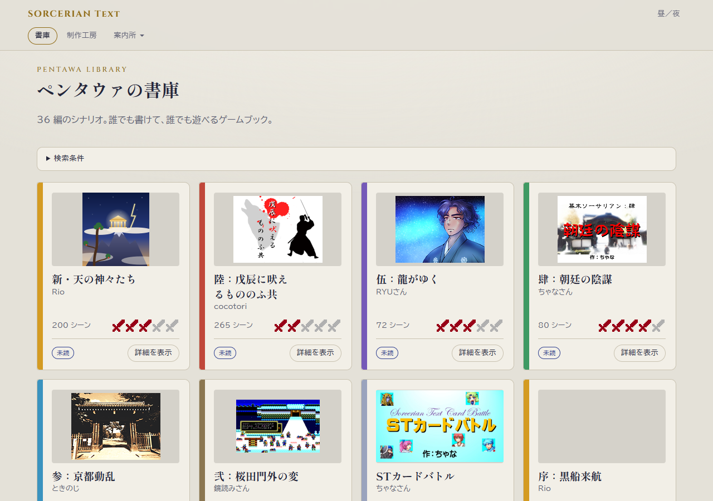
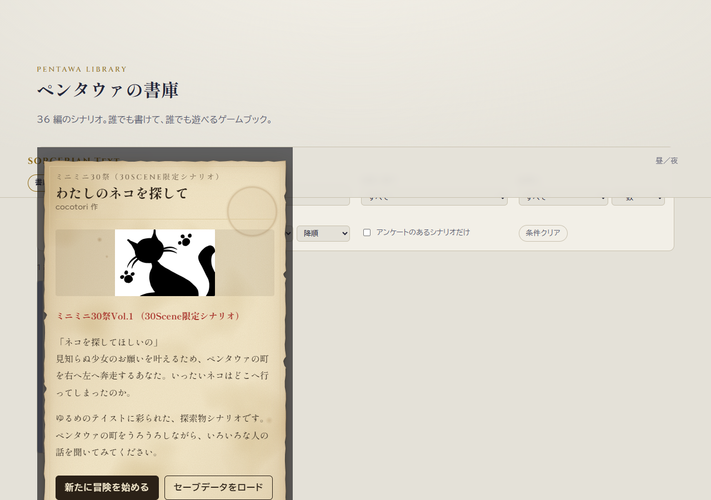
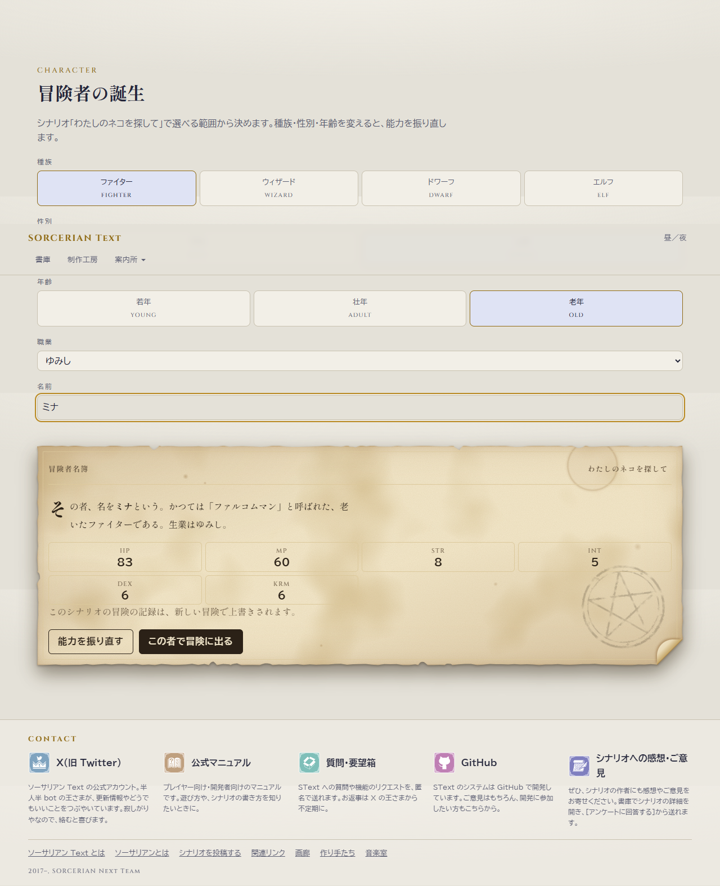
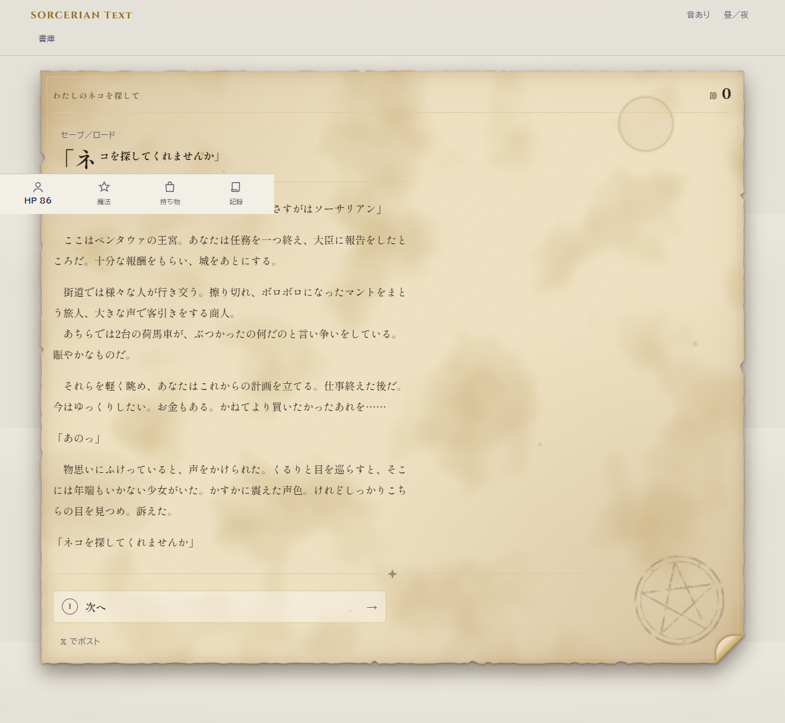
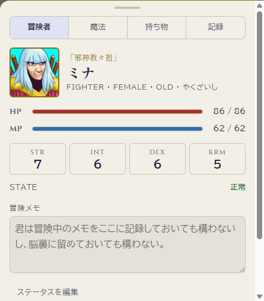
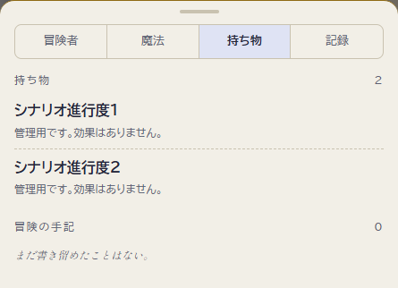
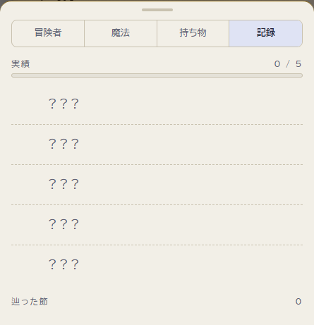
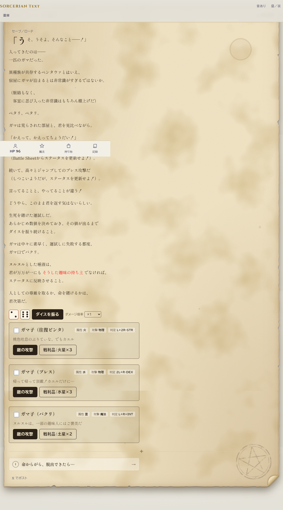
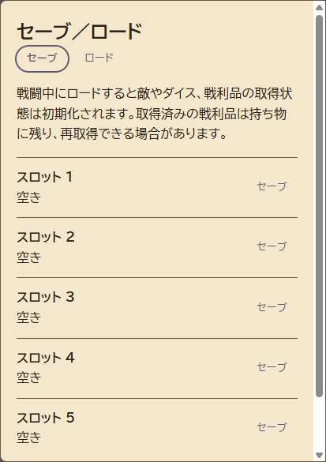
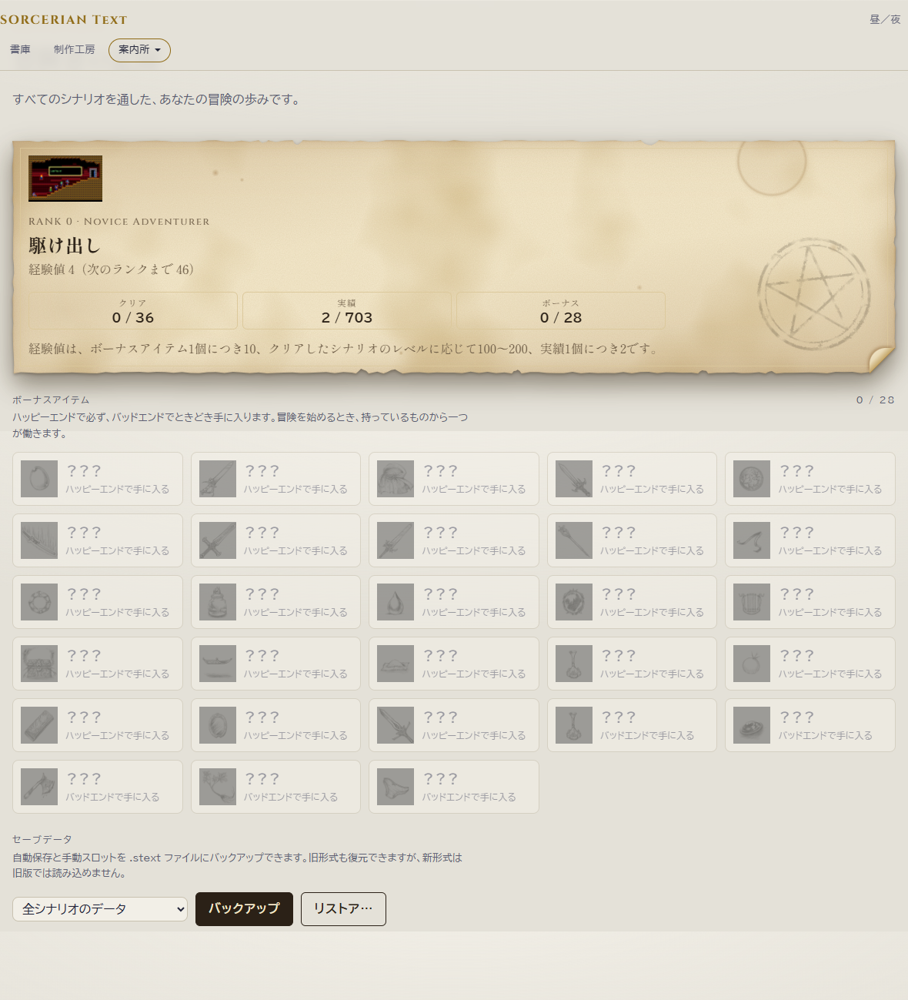

# ソーサリアン Text の遊び方

ソーサリアン Text は、文章を読みながら選択肢を選んで物語を進めるゲームブックです。アイテムやフラグ、ステータスの多くはプレイヤーが手作業で記録しなくても、プレイヤーが管理します。シナリオごとの指示も読みながら冒険を楽しんでください。

## ゲームを始める

トップページの「書庫」からシナリオを選び、「詳細を表示」を開きます。紹介文やプロローグを読んだら、新しい冒険を始めるか、保存済みの冒険を続けるかを選びます。

新しく始める場合は、冒険者の名前や種族、性別、年齢、職業を設定します。シナリオによって選べる内容は異なります。種族・性別・年齢を変更すると能力値が振り直されるので、「能力を振り直す」ボタンも使いながら冒険者を決めてください。

すでに冒険中のシナリオで新しい冒険を始めると、以前の冒険データは上書きされます。開始前に確認しましょう。

## 物語を進める

本文を読み、表示された選択肢を選ぶと次のシーンへ進みます。選択肢は、所持アイテムやフラグなどの条件によって変わることがあります。

シーンへ進むときや直前のシーンへ戻るときは、表示の更新後に画面の先頭へ戻ります。スクロールのアニメーションは行いません。冒険メモやステータスの変更では、読んでいる位置を保ちます。

通常の選択肢はボタンを押して選びます。パソコンでは、選択肢に表示された数字キー（1〜9）でも選べます。番号を入力する欄や答えを入力する欄が表示された場合は、シナリオの指示に従って入力してください。

直前のシーンに戻るには、画面の「戻る」ボタンを押します。パソコンでは Backspace キーも使えます。シナリオによっては、本文中に数値を調整する操作が表示されます。指示された値を入力して進めてください。

## 冒険者パネル

プレイ画面の「冒険者」「魔法」「持ち物」「記録」から、冒険に必要な情報を確認できます。スマートフォンでは、画面下部のメニューから開きます。

- **冒険者**：HP・MP、能力値、状態などを確認できます。「ステータスを編集」では、シナリオの指示に合わせて数値を変更できます。冒険メモもここに記録できます。
- **魔法**：所持している星の欠片と、使える魔法を確認できます。必要な星がそろっている魔法は「唱える」ボタンから使用できます。
- **持ち物**：所持アイテムと冒険の手記を確認できます。「使う」ボタンが表示されているアイテムは、そこから使用できます。
- **記録**：獲得した実績、経過シーン数、「辿った節」を確認できます。「経過シーン数」はシーンに入るたびに増え、「戻る」を使うと戻った時点の値になります。「辿った節」は「戻る」ための履歴件数で、経過シーン数とは異なります。

ステータスや星の欠片を手作業で変更した場合は、編集画面の「確定」を押してください。アイテムやフラグ、選択肢の条件判定などは、基本的にゲームの進行に合わせて管理されます。

## 戦闘

敵が登場するシーンでは、敵の情報や戦闘操作が表示されます。「この戦闘のルール」がある場合は、先に内容を確認してください。

「ダイスを振る」で判定に使うダイスを振り直せます。敵の攻撃を受けるときや攻撃するときは、該当するボタンを押すと判定結果がステータスに反映されます。ダメージ倍率の指定がある場合は、倍率を選んでください。戦利品が表示されたときは、取得ボタンから受け取れます。

複数の敵がいるときに表示されるチェック欄は、倒した敵を見分けるための目印です。シナリオ本文に特別な説明がある場合は、そちらを優先してください。

## セーブと記録

冒険の進行状況は、シーン移動やステータス変更に合わせてブラウザーに保存されます。ページを閉じたあとも、同じブラウザーで書庫を開けば「続きから」冒険を再開できます。

自動保存とは別に、シナリオごとに５個の手動セーブを作れます。プレイ画面の「セーブ／ロード」からスロットを選び、保存・ロード・削除ができます。使用済みスロットへの上書きと削除には確認が表示されます。エンディング画面ではロードのみできます。

書庫でもシナリオの詳細を開き、「セーブデータをロード」からそのシナリオのスロットを選べます。自動保存がないときやエンディング後でも、保存済みスロットから再開できます。ロードすると現在の自動保存が置き換わり、「戻る」の履歴は消えます。実績やボーナスアイテムはロード前の状態のままです。

戦闘中にロードすると、敵の HP、ダイス、撃破チェック、戦利品の取得状態などは初期化されます。取得済みの戦利品は持ち物に残るため、再取得できる場合があります。

シナリオが乱数分岐の結果を一定期間記憶する場合、その記憶はスロットに含まれず、ロードしても元に戻りません。

セーブデータはブラウザー内に保存され、別のブラウザーや端末とは自動で共有されません。ブラウザーのサイトデータを削除すると、保存データが失われることがあります。大切な冒険の記録は、定期的にバックアップしてください。

バックアップとリストアは、上部メニューの「案内所」から「冒険の記録」を開いて行います。特定のシナリオだけでなく、全シナリオのデータや基本情報も選んでバックアップできます。新しい `.stext` ファイルには自動保存と手動スロットが含まれますが、旧版では読み込めません。旧形式のファイルは引き続きリストアできます。

新形式をリストアすると、対象シナリオの自動保存と５スロットは、空きスロットも含めてファイルの内容に置き換わります。全シナリオのバックアップでは基本情報も置き換わります。実行前に対象を確認してください。

変換所から開いた、書庫の一覧にないシナリオも、手動スロットがあればバックアップに含まれます。シナリオ本体はバックアップに含まれないため、再開するには別途そのシナリオを変換所で開く必要があります。

「記録」では、シナリオのクリア状況、実績、ボーナスアイテム、プレイヤーランクも確認できます。エンディング後は「もう一度冒険する」か「ペンタウァに帰還する」を選べます。シナリオによっては、続編へデータを引き継げます。

## 画面表示と音

プレイ画面では、本文の文字サイズを「小・中・大」から、書体を「明朝・ゴシック」から選べます。書体の切り替えは本文・選択肢・敵の説明など、プレイ画面の本文部分にだけ反映されます。上部の「昼／夜」ボタンで画面テーマを切り替え、「音あり／音なし」ボタンで音を切り替えられます。設定はブラウザーに保存されます。

リロード直後は、ブラウザーの自動再生制限で音楽が流れないことがあります。「音あり」の場合は、画面をクリック・タップするか、キーを押すと BGM の再生を再試行します。「音なし」の場合は再生しません。

